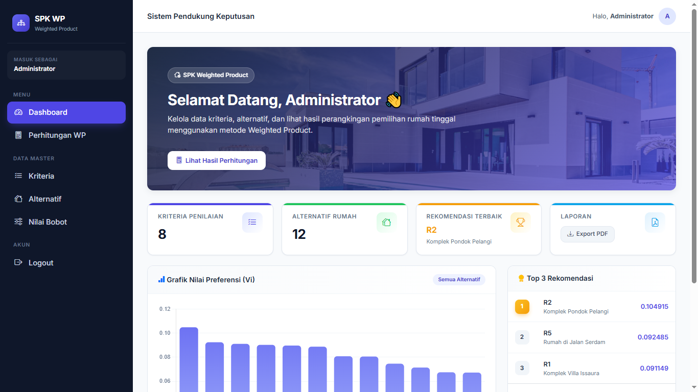
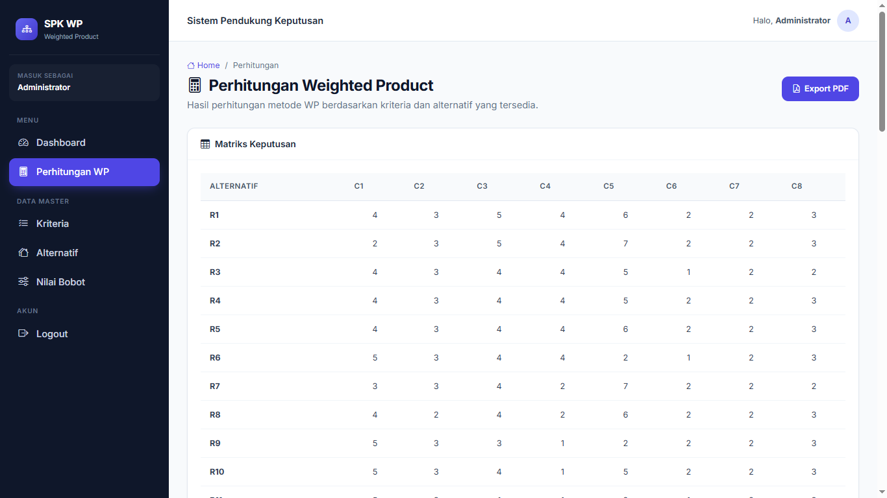
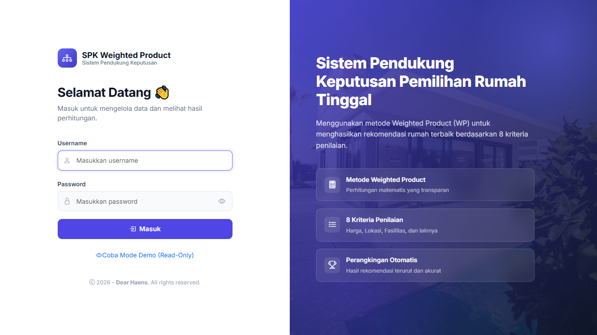
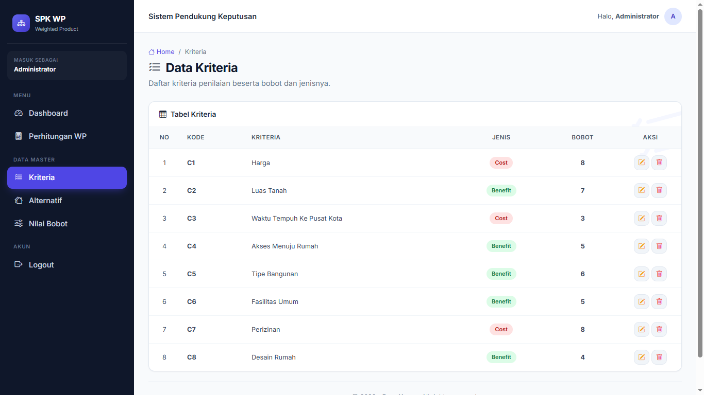

# 🏠 SPK Weighted Product — Sistem Pemilihan Rumah Tinggal

Sistem Pendukung Keputusan (SPK) berbasis web untuk membantu pengguna menentukan rekomendasi rumah tinggal terbaik menggunakan metode **Weighted Product (WP)** berdasarkan 8 kriteria penilaian yang dapat disesuaikan.


---

## ✨ Fitur Utama

- 🔐 **Autentikasi Aman** — Sistem login menggunakan password hashing (`password_hash` dan `password_verify`), proteksi SQL Injection dengan PDO Prepared Statement, serta session guard.
- 📊 **Dashboard Interaktif** — Menampilkan statistik kriteria dan alternatif, rekomendasi terbaik, serta grafik preferensi menggunakan Chart.js.
- 📋 **Manajemen Data Master** — Mengelola data kriteria, alternatif, dan nilai bobot dengan fitur CRUD.
- 🧮 **Perhitungan Weighted Product Otomatis** — Meliputi normalisasi bobot, perhitungan Vektor S, Vektor V, dan perangkingan otomatis.
- 📄 **Export PDF** — Mengunduh hasil perhitungan dalam bentuk laporan PDF menggunakan Dompdf.
- 👁️ **Mode Demo (Read-Only)** — Pengunjung dapat mencoba aplikasi tanpa login dengan proteksi server-side agar tidak dapat mengubah data.
- 🎨 **UI Modern** — Antarmuka responsif berbasis Bootstrap 5 dengan tema custom.

---

## 🖼️ Preview

Berikut beberapa tampilan aplikasi SPK Weighted Product.

| Dashboard | Perhitungan WP |
|---|---|
|  |  |

| Login | Kriteria |
|---|---|
|  |  |

---

## 🛠️ Teknologi yang Digunakan

| Kategori | Teknologi |
|---|---|
| Backend | PHP 8 (Native PHP, PDO) |
| Database | MySQL |
| Frontend | Bootstrap 5, Bootstrap Icons, Inter Font |
| Visualisasi Data | Chart.js 4 |
| PDF Generator | Dompdf |
| Notifikasi | SweetAlert2 |
| Dependency Manager | Composer |

---

## 🚀 Cara Menjalankan (Local Development)

Ikuti langkah-langkah berikut untuk menjalankan aplikasi di komputer Anda.

### Prasyarat

Pastikan perangkat telah memiliki:

- PHP 8.0 atau lebih baru.
- MySQL atau MariaDB.
- XAMPP atau Laragon.
- Composer.
- Browser seperti Google Chrome atau Mozilla Firefox.

### Langkah-langkah Instalasi

**1. Clone Repository**

Buka terminal atau PowerShell, kemudian jalankan:

```bash
git clone https://github.com/yarhns/spk-weighted-product.git
cd spk-weighted-product
```

**2. Install Dependencies**

Jalankan perintah berikut untuk menginstal seluruh dependensi proyek:

```bash
composer install
```

**3. Setup Environment**

Salin file `.env.example` menjadi `.env`.

Untuk Linux atau macOS:

```bash
cp .env.example .env
```

Untuk Windows Command Prompt:

```cmd
copy .env.example .env
```

Selanjutnya, buka file `.env` dan sesuaikan konfigurasi database dengan pengaturan MySQL lokal Anda.

Contoh konfigurasi:

```env
DB_HOST=localhost
DB_NAME=db_wp_kel9
DB_USER=root
DB_PASS=
```

**4. Import Database**

Lakukan import database melalui phpMyAdmin:

1. Jalankan Apache dan MySQL melalui XAMPP.
2. Buka browser dan akses `http://localhost/phpmyadmin`.
3. Pilih atau buat database `db_wp_kel9`.
4. Klik tab **Import**.
5. Pilih file `db_wp_kel9.sql` dari folder proyek.
6. Klik **Go** dan tunggu hingga proses import selesai.

**5. Jalankan Aplikasi**

Pastikan Apache dan MySQL sudah berjalan, kemudian buka browser dan akses:

```text
http://localhost/spk-weighted-product/
```

Aplikasi siap digunakan.

---

## 🔑 Akses Aplikasi

Aplikasi menyediakan dua mode akses:

### 1. Mode Demo (Read-Only)

Pengunjung dapat mencoba aplikasi tanpa menggunakan akun administrator.

Cara mengakses:

1. Buka halaman login.
2. Klik tombol **"Coba Mode Demo (Read-Only)"**.
3. Pengunjung akan diarahkan ke aplikasi dalam mode demo.

Dalam mode ini:

- Fitur tambah, edit, dan hapus data dinonaktifkan.
- Banner peringatan mode demo ditampilkan pada halaman.
- Data hanya dapat dilihat.
- Proteksi dilakukan melalui server-side agar perubahan data tidak dapat dilakukan melalui request langsung.

### 2. Mode Admin

Mode admin digunakan untuk mengelola seluruh data aplikasi.

Akun administrator dibuat secara langsung melalui database pada tabel `users`.

Untuk alasan keamanan, kredensial administrator tidak disertakan dalam repository ini.

#### Cara Membuat Akun Admin

**Langkah 1 — Generate Hash Password**

Buat file sementara bernama `admin/generate_hash.php`.

Masukkan kode berikut:

```php
<?php

$password = 'GANTI_DENGAN_PASSWORD_ANDA';

echo password_hash($password, PASSWORD_DEFAULT);
```

Buka file tersebut melalui browser:

```text
http://localhost/spk-weighted-product/admin/generate_hash.php
```

Salin hasil hash password yang ditampilkan.

**Langkah 2 — Insert Akun ke Database**

Buka phpMyAdmin, pilih database `db_wp_kel9`, kemudian masuk ke tab SQL.

Jalankan query berikut:

```sql
INSERT INTO users (username, password, nama_lengkap, level)
VALUES ('admin', 'HASIL_HASH_DARI_LANGKAH_1', 'Administrator', 'Admin');
```

Ganti `HASIL_HASH_DARI_LANGKAH_1` dengan hasil hash password yang telah dibuat sebelumnya.

**Langkah 3 — Hapus File Sementara**

Setelah akun administrator berhasil dibuat, segera hapus file:

```text
admin/generate_hash.php
```

Hal ini penting untuk mencegah penyalahgunaan fitur pembuat hash password.

---

## 📂 Struktur Project

Berikut gambaran struktur direktori aplikasi:

```text
spk-weighted-product/
│
├── admin/
│   ├── assets/              # CSS, JavaScript, dan gambar
│   ├── config/              # Konfigurasi koneksi database (PDO)
│   ├── functions/           # Logika bisnis dan helper WP
│   ├── template/            # Layout head, navbar, dan footer
│   │
│   ├── auth.php             # Middleware autentikasi
│   ├── index.php            # Dashboard
│   ├── hitung.php           # Perhitungan Weighted Product
│   ├── kriteria.php         # CRUD kriteria
│   ├── alternatif.php       # CRUD alternatif
│   ├── bobot.php            # CRUD nilai bobot
│   ├── export_pdf.php       # Generator laporan PDF
│   └── logout.php           # Proses logout
│
├── docs/                    # Screenshot aplikasi
│
├── vendor/                  # Dependensi Composer (tidak di-commit)
│
├── .env.example             # Template konfigurasi environment
├── .gitignore               # Konfigurasi Git
├── composer.json            # Dependensi proyek
├── composer.lock            # Versi dependensi
├── db_wp_kel9.sql           # Struktur dan data database
├── index.php                # Halaman login
└── README.md                # Dokumentasi proyek
```

---

## 🧠 Tentang Metode Weighted Product

**Weighted Product (WP)** merupakan salah satu metode Sistem Pendukung Keputusan (SPK) yang menggunakan perkalian untuk menghubungkan nilai atribut alternatif dengan bobot kriteria.

Metode ini digunakan untuk menentukan alternatif terbaik berdasarkan sejumlah kriteria yang telah ditentukan.

### Tahapan Perhitungan

**1. Normalisasi Bobot (Wj)**

Normalisasi dilakukan untuk mendapatkan bobot relatif setiap kriteria.

\[
W_j = \frac{w_j}{\sum_{j=1}^{n} w_j}
\]

Keterangan:

- \(W_j\) = Bobot kriteria yang telah dinormalisasi.
- \(w_j\) = Bobot awal setiap kriteria.
- \(n\) = Jumlah seluruh kriteria.

Untuk kriteria bertipe **Cost**, bobot diberikan tanda negatif dalam proses perhitungan.

**2. Menghitung Vektor S (Si)**

Menghitung nilai preferensi relatif setiap alternatif menggunakan perkalian nilai kriteria yang telah dipangkatkan dengan bobot ternormalisasi.

\[
S_i = \prod_{j=1}^{n} X_{ij}^{W_j}
\]

**3. Menghitung Vektor V (Vi)**

Menghitung nilai preferensi relatif untuk setiap alternatif.

\[
V_i = \frac{S_i}{\sum_{i=1}^{m} S_i}
\]

**4. Perangkingan**

Alternatif diurutkan berdasarkan nilai preferensi Vektor V dari yang terbesar hingga terkecil.

Alternatif dengan nilai Vektor V tertinggi merupakan rekomendasi rumah tinggal terbaik berdasarkan kriteria dan bobot yang digunakan.

---

## 📄 Lisensi

Proyek ini menggunakan **MIT License**.

Anda bebas menggunakan, mempelajari, memodifikasi, dan mengembangkan proyek ini untuk keperluan pembelajaran maupun portofolio dengan tetap mencantumkan atribusi sesuai ketentuan lisensi.

---

## 👤 Author

**Dear Haens**

*Web Developer Enthusiast*

- GitHub: [@yarhns](https://github.com/yarhns)
- Repository: [SPK Weighted Product](https://github.com/yarhns/spk-weighted-product)
- LinkedIn: Belum tersedia.

---

## 🙏 Ucapan Terima Kasih

Terima kasih kepada para pengembang dan komunitas teknologi yang telah menyediakan berbagai tools dan library untuk mendukung pengembangan proyek ini:

- [Bootstrap](https://getbootstrap.com/) — Framework antarmuka.
- [Chart.js](https://www.chartjs.org/) — Visualisasi data dan grafik.
- [Dompdf](https://github.com/dompdf/dompdf) — Pembuatan laporan PDF.
- [SweetAlert2](https://sweetalert2.github.io/) — Notifikasi interaktif.
- [Unsplash](https://unsplash.com/) — Sumber gambar untuk hero dashboard.

---


